# (LGE Only) FOSSLight Scanner Service 

## 개요
{: .left-bar-title}
웹서비스로 [FOSSLight Scanner](https://fosslight.org/fosslight-guide/scanner/)를 이용하여 Source, Binary, Dependency 분석을 수행합니다. 분석 결과는 [FOSSLight Report](https://fosslight.org/hub-guide/learn/2_fosslight_report.html) 형태로 생성됩니다.    
- URL : [http://fs.lge.com](http://fs.lge.com)
- 분석 항목 
    - [FOSSLight Source Scanner](https://fosslight.org/fosslight-guide/scanner/2_source.html)
    - [FOSSLight Binary Scanner](https://fosslight.org/fosslight-guide/scanner/3_binary.html)
    - [FOSSLight Dependency Scanner](https://fosslight.org/fosslight-guide/scanner/1_dependency.html)
        - 지원하는 package manager : npm, pypi, maven, pub, go, nuget, cargo, swift, carthage.  
          (그 외 package manager은 검증 진행 중)  
- 미지원 항목
    - [FOSSLight Android Scanner](https://fosslight.org/fosslight-guide/android/)
    - [FOSSLight Yocto Scanner](https://fosslight.org/fosslight-guide/yocto/)

## 사용 방법
{: .left-bar-title}

### 로그인
{: .specific-title}
- [http://fs.lge.com](http://fs.lge.com)에서 AD 계정 ID와 비밀번호를 입력하여 접속합니다. 
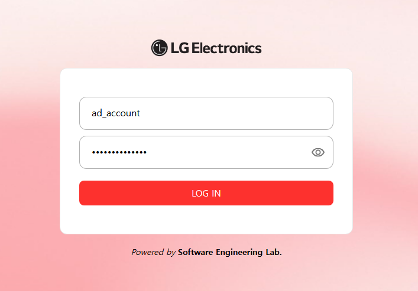{: .styled-image}  

### Create a Project 
{: .specific-title} 
1. 우측 상단의 "New Project" 버튼을 클릭하여 Project를 생성합니다.  
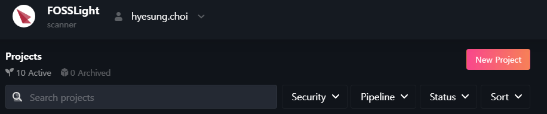{: .styled-image}  

2. "Create a Project"에 내용을 입력합니다.  
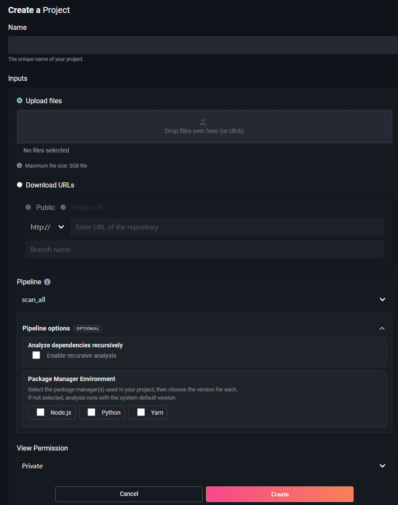{: .styled-image}
    - **Name** : Project 이름을 입력합니다.
    - **Inputs** : 분석할 소스를 선택합니다.
        - **Upload files** : 분석할 파일을 압축하여 업로드합니다. (1개만 업로드)
              ⚠️ 최대 3GB까지 업로드 가능
        - **Download URLs** : 분석할 소스 링크 (wget 또는 git clone 하여 받을 수 있는 링크)를 입력합니다.
            - **Public** : 공개된 Repository인 경우 
                - 입력값 예시
                    - wget : github.com/LGE-OSS/example/archive/refs/tags/v1.0.0.zip
                    - git clone : github.com/LGE-OSS/example
            - **Private Git** : Private git 인 경우
                - **http://** 또는 **https://** : user name과 PAT 값을 입력합니다. 
                - **ssh://** : 제공되는 ssh key 값을 복사하여 private git repository에 등록합니다. ⚠️ github, bitbucket은 ssh 대신 PAT 를 이용해야 합니다.  
                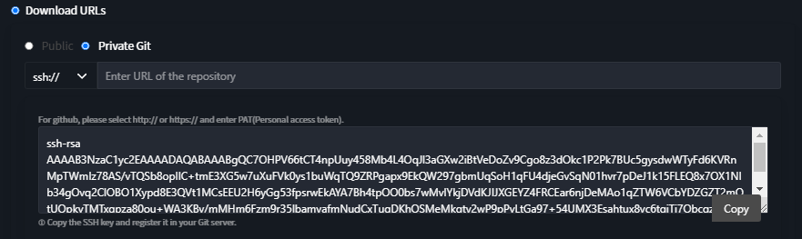{: .styled-image}  
    - **Pipeline**
        - scan_all : source, binary, dependency 분석
        - source : source code만 분석 
        - binary : binary만 분석
        - dependency : dependency만 분석
    - **Pipeline options (Optional)**
        - Analyze dependencies recursively : 프로젝트 최상위 디렉토리뿐만 아니라 전체 하위 디렉토리의 manifest 파일을 감지하여 재귀적으로 dependency를 분석하려면, 'Enable recursive analysis' 체크박스를 선택합니다.
        - Package Manager Environment : Dependency 분석 시 특정 버전의 패키지 매니저를 사용하려면, 언어 또는 패키지 매니저를 선택한 후 버전 목록에서 원하는 버전을 선택할 수 있습니다.
    - **권한 설정**
        - Private : 생성자만 조회 가능
        - Public : 링크를 통해 해당 Project를 다른 사람이 볼 수 있고 분석 결과를 다운로드할 수 있음 

### 분석 결과
{: .specific-title}

3.0.0부터 분석이 끝나면 프로젝트 화면의 개수를 눌러 결과를 열고 왼쪽 트리와 오른쪽 OSS 표에서 검출 내용을 확인한 뒤 Identify 할 수 있습니다.  
Identify는 스캐너가 찾은 값 위에, 사용자가 확인한 OSS 이름·버전·라이선스·Download location·Comment·Exclude를 덮어 저장하는 기능입니다.     
저장한 값은 분석 결과가 다시 만들어져도 같은 경로(Dependency는 같은 purl)에 다시 붙고 [FOSSLight Hub Identification](https://fosslight.org/hub-guide/tutorial/1_project/2_Identification/)에 올리는 FOSSLight Report에 반영됩니다.

Creator와 Editor만 Identify 권한이 부여됩니다.    
분석이 실행 중이거나 프로젝트가 archived이면 수정도 닫힙니다.

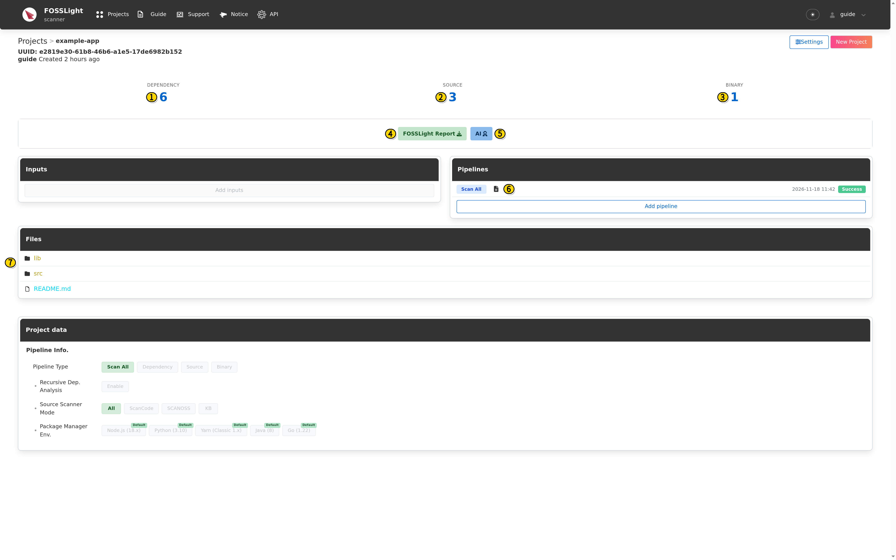{: .styled-image}

1. **Dependency** : 검출된 패키지 수입니다. 숫자를 누르면 Dependency 트리가 열립니다.
2. **Source** : OSS가 검출된 소스 파일 수입니다. 숫자를 누르면 Source 파일 트리가 열립니다.
3. **Binary** : 바이너리 파일 수입니다. 숫자를 누르면 Binary 파일 트리가 열립니다. 개수가 0이면 해당 화면으로 들어가지 않습니다.
4. **FOSSLight Report** : Hub Identification에 업로드하는 리포트입니다. Identify를 저장한 적이 있으면 확인한 값이 반영된 리포트를 받고 아직 Identify 전이면 스캐너 결과 리포트를 받습니다.
5. **AI** : 분석 결과의 요약, 위험도, 대응 방안을 확인합니다.
6. **Log** : Pipelines에서 실행 건 옆 아이콘입니다. 그 실행의 로그를 받습니다. 프로젝트 목록의 Download에서도 Log와 리포트를 받을 수 있습니다.
7. **Files** : 업로드한 파일과 폴더 목록입니다. 항목을 누르면 파일 트리가 열립니다. Dependency로 검출된 패키지는 이 목록에 나오지 않고 1번 개수에서 확인합니다.

#### 결과 화면
{: .specific-title}

개수를 누르면 아래 화면이 열립니다. 위의 탭으로 Dependency, Source, Binary, Source + Binary를 바꿉니다. Source와 Binary를 오갈 때는 보고 있던 경로와 필터가 유지됩니다. Dependency는 별도의 트리입니다.

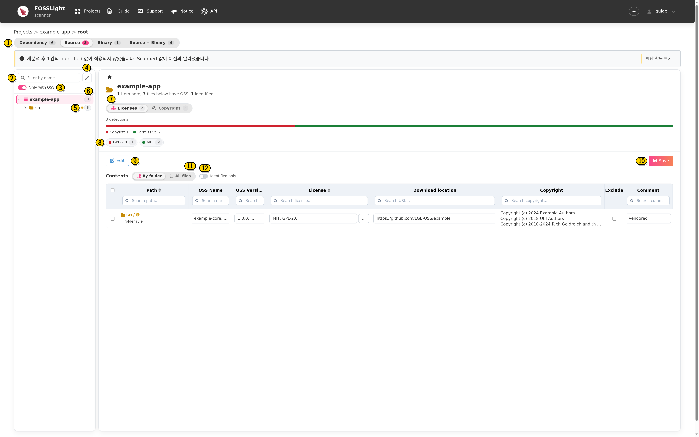{: .styled-image}

1. **결과 탭** : Dependency, Source, Binary, Source + Binary. 개수는 패키지 수, OSS가 있는 소스 파일 수, 바이너리 파일 수, 그 둘을 합친 수입니다. 개수가 0인 탭은 선택할 수 없습니다. Source와 Binary를 오갈 때는 보고 있던 경로와 필터가 유지됩니다.
2. **Filter by name** : 이미 불러온 항목 중 이름에 글자가 포함된 것만 남깁니다.
3. **Only with OSS** : Source/Binary 트리에서 OSS가 있는 파일만 보여 줍니다. 끄면 검출이 없는 파일도 트리에 나옵니다.
4. **접기 / 펼치기** : 불러온 폴더를 모두 접거나 펼칩니다. 트리와 오른쪽 영역 사이 경계를 끌면 폭이 바뀝니다.
5. **상태 점** : 이름 옆 점입니다. 파란색은 Scanned, 노란색은 Identified입니다. 노란색이 반만 채워지면 Partly identified입니다. 점에 마우스를 올리면 그 상태가 글로 표시됩니다.
6. **폴더 숫자** : 그 아래에 OSS가 있는 파일 수입니다.
7. **Licenses** : 선택한 폴더 아래에 검출된 라이선스를 유형 막대와 칩으로 보여 줍니다. 유형은 Copyleft, Proprietary, Unclassified, Weak Copyleft, Permissive, Proprietary Free 순입니다.
8. **라이선스 칩** : 이름을 누르면 그 라이선스가 있는 경로만 남고 숫자를 누르면 그 라이선스가 있는 파일을 목록으로 엽니다. 긴 목록은 **+ more** 로 펼칩니다. 선택한 라이선스는 트리 위의 칩에서 지웁니다.
9. **Edit** : 체크한 행을 한 번에 수정하는 창을 엽니다.
10. **Save** : 칸에 직접 입력한 값을 저장합니다.
11. **By folder / All files** : By folder는 선택한 폴더 바로 아래의 폴더와 파일, All files는 그 아래 모든 깊이의 파일입니다.
12. **Identified only** : 상태가 Identified인 행만 남깁니다.

파일 트리의 OSS 표입니다. Column header 아래 검색은 칸 내용의 일부만 맞아도 되고 대소문자를 구분하지 않습니다. 여러 열을 함께 쓰면 모든 검색에 맞는 행만 남습니다.

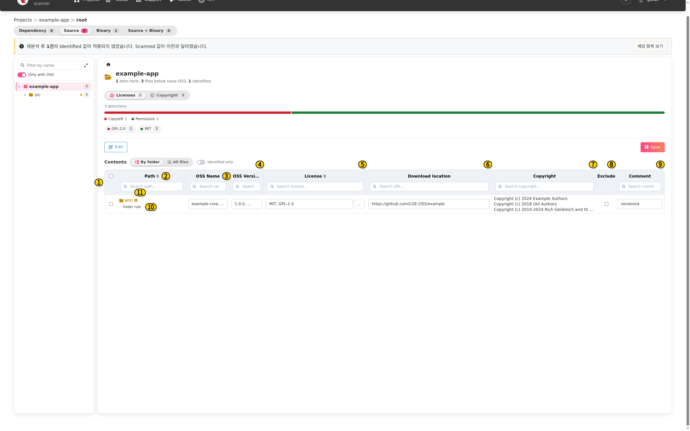{: .styled-image}

1. **행 선택** : 체크박스는 지금 페이지의 행을 모두 선택합니다.
2. **Path** : File이 위치하는 경로입니다.
3. **OSS Name** : Open Source Software Name입니다.
4. **OSS Version** : Open Source Software Version입니다.
5. **License** : **...** 버튼은 FOSSLight 라이선스 목록입니다. 여러 개를 고르면 쉼표로 이어서 저장됩니다.
6. **Download location** : OSS의 소스 코드를 다운받을 수 있는 URL입니다.
7. **Copyright** : 길면 줄여 보여 줍니다. 스캐너가 찾은 값이라 Identify로 고치지 않습니다. 칸에 마우스를 올리면 모든 Copyright를 확인할 수 있고 3줄 이상일 경우 클릭하여 복사할 수 있습니다.  
8. **Exclude** : 체크하면 그 행은 FOSSLight Report에서 빠집니다.
9. **Comment**
10. **folder rule** : 폴더 행을 수정해 저장하면, 그 폴더 아래에서 이미 OSS가 검출된 경로가 같은 값을 물려받습니다. 파일에 직접 저장한 값이 우선합니다. 물려받은 행에는 **inherited**가 붙습니다. OSS가 없는 파일에는 적용되지 않습니다.
11. **정보 아이콘** : 그 경로를 Identify 했다는 표시입니다.

Copyright 탭입니다.

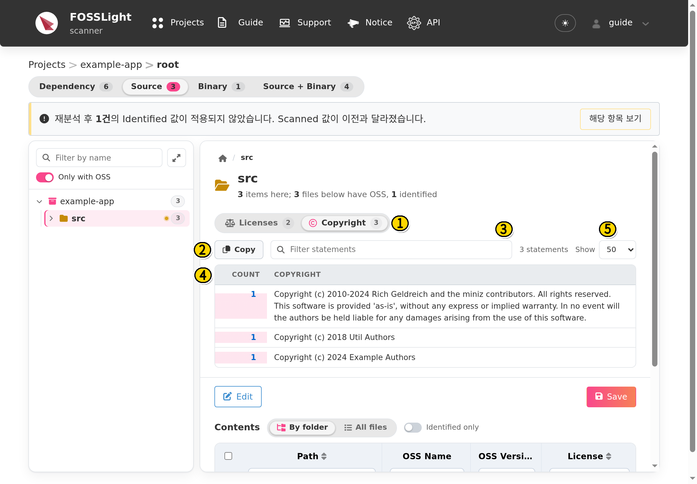{: .styled-image}

1. **Copyright** : Copyright 확인할 수 있는 메뉴입니다.
2. **Copy** : 보이는 Copyright를 모두 복사합니다.
3. **검색** : 입력한 text로 필터링된 항목만 보입니다.
4. **COUNT** : 그 문장이 나온 파일 수입니다. Dependency에서는 패키지 수입니다. 문장을 누르면 그 문장이 있는 항목만 목록에 남습니다.
5. **페이지당 개수** : 한 페이지에 보여줄 Copyright 수입니다.

Dependency 트리입니다.

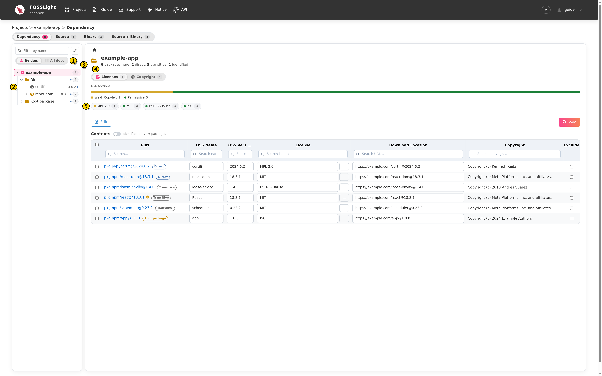{: .styled-image}

1. **By dep. / All dep.** : By dep.은 Direct 아래의 패키지에서 종속 관계를 확인할 수 있습니다. All dep.은 Direct, Transitive, Root package 그룹 안에 패키지를 나열하여 중복되더라도 한 번만 보여 줍니다.
2. **Direct** : Direct 패키지입니다. Transitive, Root package도 같은 트리에 있습니다.
3. **패키지 수** : 그 아래에 있는 패키지 수입니다.
4. **Licenses** : 선택한 그룹의 라이선스 탭입니다. 파일 트리의 7번과 같습니다.
5. **라이선스 칩** : 파일 트리의 8번과 같습니다.

Dependency OSS 표입니다. Comment 열은 없고 패키지를 선택하면 카드에서 Comment를 확인합니다.

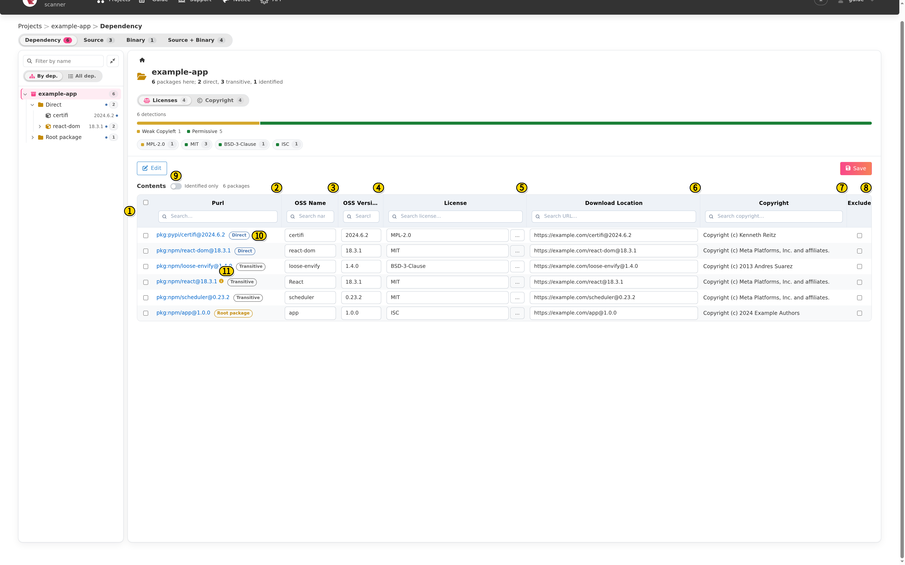{: .styled-image}

1. **행 선택**
2. **Purl**
3. **OSS Name**
4. **OSS Version**
5. **License**
6. **Download Location**
7. **Copyright**
8. **Exclude**
9. **Identified only** : 파일 트리의 12번과 같습니다.
10. **관계 배지** : Direct, Transitive, Root package 중 하나입니다.
11. **정보 아이콘** : 그 패키지를 Identify 했다는 표시입니다.

파일 카드입니다. 패키지를 선택하면 같은 OSS 칸과 함께 **Depends on**, **Required by**가 나와 의존 관계를 따라갑니다.

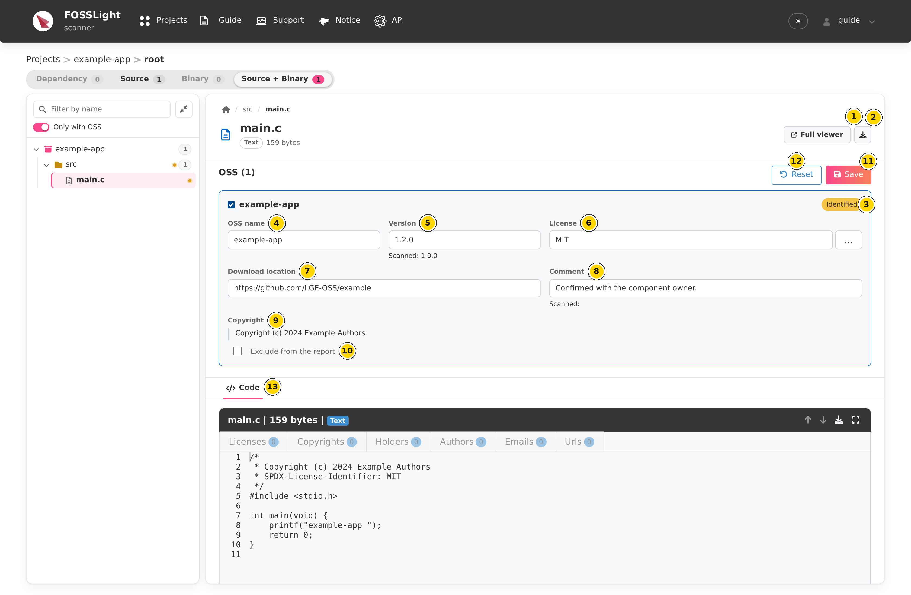{: .styled-image}

1. **Full viewer** : 파일 세부 내용을 확인하는 메뉴입니다.
2. **다운로드**
3. **Identified / Scanned** : Identified는 스캐너 값과 다르게 저장한 상태이고 Scanned는 스캐너 값 그대로인 상태입니다.
4. **OSS name**
5. **Version**
6. **License** : 오른쪽 **...** 로 라이선스 목록을 열어 사용한 라이선스를 선택합니다.
7. **Download location**
8. **Comment**
9. **Copyright**
10. **Exclude from the report** : 표의 Exclude와 같습니다.
11. **Save**
12. **Code** : 매칭된 줄을 강조해서 보여 줍니다.
