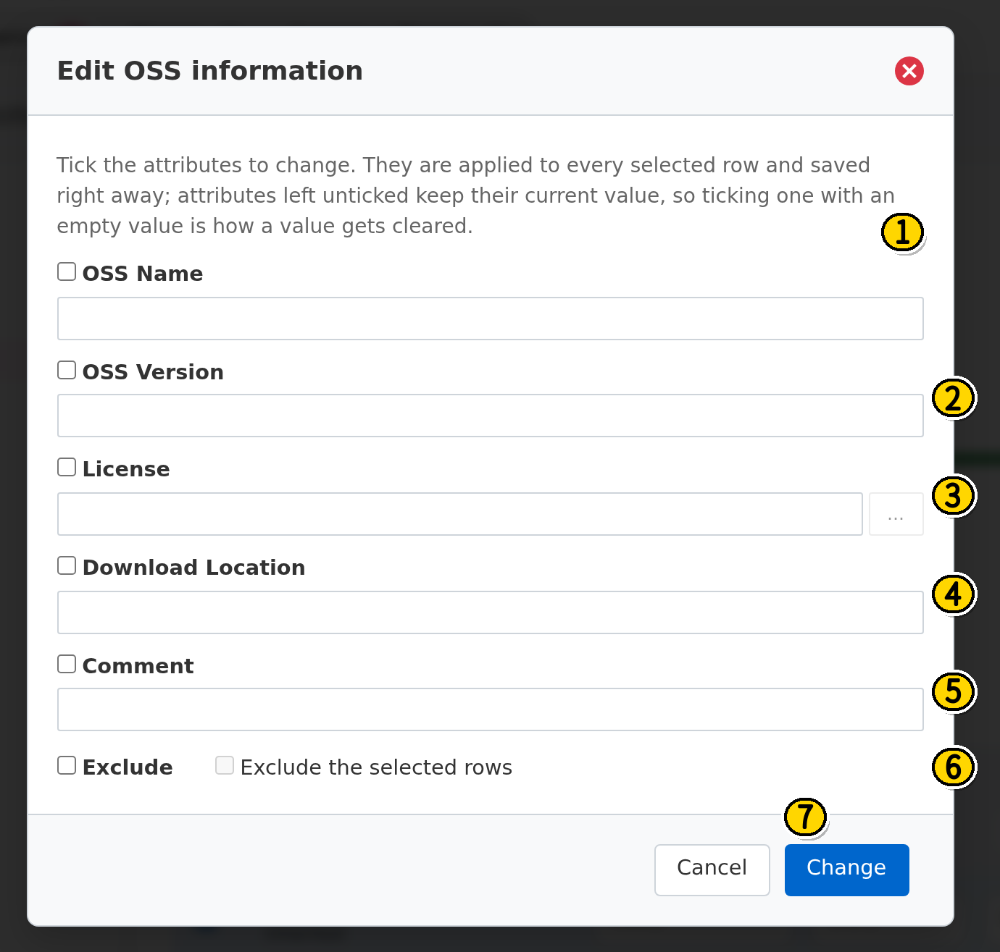

# Identify 기능이란?

분석 결과 화면에서 스캐너가 분석한 OSS 정보를 확인하고, 수정이 필요한 OSS 정보를 수정 후 저장하는 기능입니다. 

저장되는 정보은 OSS Name, OSS Version, License, Download location, Comment, Exclude입니다. Copyright는 스캔된 그대로의 값이라 Identify 기능으로는 수정할 수 없습니다.

Identified된 정보는 분석된(Scanned) 결과와 따로 보관됩니다.     
같은 프로젝트를 다시 분석하면 파일은 경로로, Dependency는 purl로 저장된 identified 정보가 나옵니다.     
Identified 정보가 하나라도 적용 중이면 [FOSSLight Report](https://fosslight.org/hub-guide/learn/2_fosslight_report.html) 다운로드는 그 값이 반영된 리포트입니다.     
Identified 작업이 끝났다면 이 report를 [FOSSLight Hub Identification](https://fosslight.org/hub-guide/tutorial/1_project/2_Identification/)에 업로드합니다.

## 누가 Identify 기능을 사용할 수 있나요?
{: .left-bar-title}

프로젝트 생성자, Settings에서 추가한 editor가 사용할 수 있습니다. Editor를 추가하고 빼는 일은 생성자와 관리자가 Settings에서 합니다.

아래 상황에서는 Identify 기능을 이용할 수 없습니다.
- 분석이 대기 중이거나 실행 중인 경우
- 프로젝트가 archived된 경우

## Identify 기능 이용 방법
{: .left-bar-title}

프로젝트 화면의 Dependency, Source, Binary 개수를 누르면 아래와 같은 결과 화면이 열립니다.     

< Path 기반 >    
파일 식별은 경로에 저장됩니다. Source, Binary, Source + Binary에서 같은 파일을 열면 같은 저장 값이 보입니다. Source와 Binary를 오갈 때는 보고 있던 경로와 필터가 유지됩니다.

< 의존 관계 기반 >    
Dependency 식별은 purl에 저장됩니다. 파일 트리의 폴더 규칙과는 따로입니다.

{: .styled-image}

1. **결과 탭** : Dependency, Source, Binary, Source + Binary 탭 중 선택합니다. 
2. **Filter by name** : 이미 불러온 항목 중 이름에 글자가 포함된 것만 남깁니다.
3. **Only with OSS** : Source와 Binary 트리에서 OSS가 있는 파일만 보여 줍니다. 끄면 검출이 없는 파일도 트리에 나옵니다. 검출이 없는 파일에는 폴더 규칙이 적용되지 않습니다.
4. **접기 / 펼치기** : 불러온 폴더를 모두 접거나 펼칩니다.
5. **Status 점** : 파란색은 scanned며, 노란색은 identified되었음을 나타냅니다. (아래 상세 설명)
6. **폴더 숫자** : 그 아래에 OSS가 있는 파일 수입니다.
7. **Licenses** : 선택한 폴더 아래에 검출된 라이선스를 유형 막대와 칩으로 보여줍니다.
8. **License chip** : 이름을 누르면 그 라이선스가 있는 경로만 남고, 숫자를 누르면 그 라이선스가 있는 파일을 목록으로 엽니다.
9. **Copyright** : 선택된 path의 Copyright의 빈도별 개수를 확인할 수 있고, 복사도 가능합니다.
9. **Edit** : 여러 행을 한 번에 수정하는 창을 엽니다.
10. **Save** : 칸에 직접 입력한 값을 저장합니다.
11. **By folder / All files** : By folder는 선택한 폴더 바로 아래의 폴더와 파일입니다. 폴더 행을 고치면 폴더 규칙이 됩니다. All files는 그 아래 모든 깊이의 파일입니다.
12. **Identified only** : 상태가 Identified인 행만 남깁니다.

Column header 아래 검색은 내용의 일부만 맞아도 되고 대소문자를 구분하지 않습니다.    
여러 열을 함께 쓰면 모든 검색에 맞는 행만 남습니다.

## 상태를 읽는 법
{: .left-bar-title}

한 행의 상태는 지금 화면에 나온 값이 분석 결과(Scanned)와 같은지로 정해집니다.

- **Scanned** : 화면에 나온 값이 이번 분석 결과 값과 같습니다. 파일 트리의 점은 파란색입니다.
- **Identified** : Identified 된 항목으로 파일 트리의 점은 노란색입니다. 파일 카드에는 Identified 또는 Scanned 태그가 붙습니다.
- **Partly identified** : 폴더 점만 해당합니다. 노란색이 반만 채워집니다. 그 폴더 아래에서 OSS가 있는 파일 중 일부만 Identified 된 것이고, 그 폴더에는 폴더 규칙이 없습니다. 점에 마우스를 올리면 상태가 글로 나옵니다.

폴더에 폴더 규칙이 있거나, 그 아래 OSS가 있는 파일이 모두 Identified면 폴더 점은 노란색입니다.    
OSS가 없는 파일은 점이 없고, 폴더 규칙도 받지 않습니다.     
Path 또는 Purl 옆 정보 아이콘은 그 경로나 패키지에 저장한 Identified 정보가 있다는 표시입니다. 마우스를 올리면 Identified라고 나옵니다.

{: .styled-image}

## Identify 이용 시 작성할 정보
{: .left-bar-title}

| 칸 | 저장 |
| --- | --- |
| OSS Name | 실제 사용한 OSS Name |
| OSS Version | 실제 사용한 OSS Version(Tag로 확인 가능한) |
| License | 확인한 라이선스. 여러 개는 쉼표로 이어집니다. 순서만 바뀐 것은 변경으로 보지 않습니다. |
| Download location | Source Code를 다운로드 가능한 URL |
| Comment | 확인 메모. |
| Exclude | 체크하면 그 행은 FOSSLight Report에서 빠집니다. 파일 카드의 **Exclude from the report**와 같습니다. |
| Copyright | Scan값 그대로이므로 수정 불가. 길면 줄여 보여 주고, 칸에 마우스를 올리면 전체를 봅니다. 3줄 이상이면 클릭하면 복사됩니다. |

칸을 건드리지 않고 **Save**를 누르면 그 칸은 스캐너가 찾은 값으로 남습니다. 칸을 비우고 저장하면 그 값을 지운 것으로 남습니다. 라이선스를 비우면 라이선스 없음으로 저장됩니다.

Identified된 값을 이전의 Scanned 값으로 다시 저장하면 Identified 식별은 지워지고 Scanned로 돌아갑니다.   

한 경로에 스캐너가 OSS를 둘 이상이면 표에 행이 각 OSS로 등록되고 OSS마다 따로 저장합니다.

선택한 행이 없거나 바뀐 칸이 없는데 버튼을 누르면 알림이 나옵니다. 알림 문구는 `Select at least one row to edit.` 또는 `There are no changes to save.`입니다.

## Identify 하는 방법
{: .left-bar-title}

### 1개의 패키지/File를 Identify 하는 방법
{: .specific-title}

1. 1개의 Dependency 또는 File를 클릭합니다.
2. 표의 칸에 직접 입력합니다. License는 칸에 적거나 오른쪽 **...** 로 목록에서 고릅니다.
2. **Save**를 누릅니다.
3. 저장이 끝나면 화면이 다시 열리고 상태가 바뀝니다.

{: .styled-image}

파일 카드에서 같이 보는 항목입니다. 번호는 위 화면과 같습니다.

1. **Full viewer** : 파일 세부 내용을 확인하는 메뉴입니다. 식별 값과는 별개입니다.
2. **다운로드** : 파일을 다운로드 받습니다.
3. **Identified / Scanned** : 이 Dependency 혹은 File의 상태를 보여줍니다.
4. **OSS name**
5. **Version**
6. **License** : 직접 입력하거나 오른쪽 **...** 로 라이선스 목록을 열어 선택할 수 있습니다.
7. **Download location**
8. **Comment**
9. **Copyright**
10. **Exclude from the report** : Report에서 제외하려면 체크합니다.
11. **Save**
12. **Code** : 매칭된 줄을 강조해서 보여 줍니다. 식별 값은 여기서 고치지 않습니다.

패키지를 선택하면 같은 OSS 칸과 함께 **Depends on**, **Required by**가 나와 의존 관계를 따라갑니다.

### 여러 개의 패키지/경로를 한 번에 Identify 하는 법(Bulk Edit)
{: .specific-title}

1. 한번에 수정할 행 앞의 체크박스를 선택합니다. Table Hedaer의 체크박스는 지금 페이지의 행을 모두 선택합니다. 다른 페이지의 행은 포함되지 않습니다.
2. **Edit**를 누릅니다.
3. 바꿀 항목만 체크합니다. 체크하지 않은 항목은 선택된 모든 행에서 그대로 둡니다.
4. 체크한 칸에 넣을 값을 적습니다. 값을 지우려면 그 항목을 체크하고 칸을 비웁니다.     
5. **Change**를 누릅니다. 선택된 모든 행에 바로 저장됩니다.

{: .styled-image}

### 라이선스 목록에서 고르기
{: .specific-title}

Bulk Edit의 경우, License 칸의 **...** 는 그 칸의 라이선스 체크를 켠 뒤에 열립니다.     
OSS Table과 file 카드에서는 **...** 를 바로 누릅니다.

1. **Filter the list**에 글자를 넣어 목록을 줄입니다.
2. 목록에서 하나 이상을 선택합니다.
3. **Apply**를 누릅니다. 고른 라이선스가 쉼표로 이어져 칸에 들어갑니다. 이어서 **Save** 또는 **Change**로 저장합니다.

{: .styled-image}

목록에 없는 라이선스는 License 칸에 직접 적습니다.

## 폴더 규칙(Folder Rule)
{: .left-bar-title}

폴더 행을 수정하여 Identified하면 그 폴더의 규칙이 됩니다. By folder에서 폴더를 선택하면 그 폴더 행이 표에 나옵니다. 규칙을 저장한 폴더 행에는 **folder rule**이 붙습니다.

규칙은 그 폴더 아래에서 이미 OSS가 검출된 경로에 적용됩니다. Source와 Binary를 가리지 않습니다.     
**OSS가 없는 파일, Dependency 패키지에는 적용되지 않습니다.**

< 적용 순서 >
1. 처음에 보이는 값은 Scanner가 분석한 Scanned 값입니다.
2. 더 상위 폴더의 규칙은 합쳐지지 않고, 상위의 가장 가까운 폴더 규칙이 적용됩니다.     
3. 그 파일 행에 직접 저장한 값이 있으면 그 값이 최종입니다. (Folder rule 보다는 개별 파일 수정이 우선 적용)

Folder Rule이 적용된 경로에는 **inherited**로 표기됩니다. 파일에 직접 저장한 행에는 inherited가 붙지 않고, 그 파일 값이 폴더 규칙보다 우선 적용됩니다.    

Identified 이후, 이전의 Scanned 값을 다시 저장하면 Folder Rule 적용은 해제됩니다.     
아래 폴더의 규칙을 모두 풀면, 더 상위 폴더 규칙이 다시 보입니다.

Folder Rule은 다시 분석해도 유지됩니다. 한 파일의 스캐너 값이 바뀌어도 Folder Rule 자체는 경고 대상이 되지 않습니다. 파일 행에 직접 저장한 값만 아래의 재분석 확인을 받습니다.

## Dependency에서 다른 점
{: .left-bar-title}

{: .styled-image}

- 행의 키는 Path가 아니라 **Purl**입니다. 같은 purl이 여러 manifest에 있어도 식별은 purl당 하나입니다.
- **Dependency 배지**는 Direct, Transitive, Root package 중 하나입니다. 식별 값과는 별개이고, 고칠 수 없습니다.
- 정보 아이콘은 그 패키지를 Identify 했다는 표시입니다.
- Path 기반이 아니므로 Folder Rule은 없습니다.

By dep.은 Direct 아래 패키지의 종속 관계를 보여 줍니다. All dep.은 Direct, Transitive, Root package 그룹으로 패키지를 나열하고, 중복되더라도 같은 패키지는 한 번만 보여 줍니다. 어느 쪽으로 보든 저장되는 purl은 같습니다.

## FOSSLight Report
{: .left-bar-title}

프로젝트 화면의 **FOSSLight Report**는 Hub Identification에 올리는 파일입니다.

- 적용 중인 Identified 값이 있다면 이 값이 반영된 리포트를 받습니다.
- 아직 Identified 값이 전혀 없으면 Scanned된 결과 그대로의 리포트를 받습니다.
- Exclude를 체크한 행은 리포트에서 빠집니다.
- 프로젝트 목록의 Download 아이콘으로도 리포트를 받을 수 있습니다.

Identified 값을 이전의 Scanned 값과 같게 되돌려 저장 기록이 모두 사라지면, 이후 다운로드는 다시 스캐너 결과 리포트입니다.

## 재분석 이후
{: .left-bar-title}

파일이나 패키지에 Identified한 값은 이번 스캔 결과의 이름, 버전, 라이선스, Download location, Comment, Exclude 값이 같을 때만 자동으로 다시 보여집니다.    
만약, 이 값 중 하나라도 달라지면 identified된 정보로 보이지 않습니다.    
화면은 새 스캐너 값을 보여 주고, 표를 보기 전에 경고가 나옵니다.

저장할 수 있는 사람(Creator, Editor)에게만 이 경고가 보입니다.

{: .styled-image}

1. **경고** : 재분석 후 적용되지 않은 건수입니다. 문구는 `재분석 후 N건의 Identified 값이 적용되지 않았습니다. Scanned 값이 이전과 달라졌습니다.`입니다.
2. **해당 항목 보기** : 적용되지 않은 행만 남깁니다. 그 상태에서는 배너가 `적용되지 않은 N건만 표시하고 있습니다.`로 바뀌고, 버튼은 **전체 목록 보기**가 됩니다.
3. **경고 아이콘** : OSS Name 앞에 있습니다. 누르면 비교 창이 열립니다. 이 창에서 처리하기 전에는 그 행의 저장 값이 적용되지 않습니다.

{: .styled-image}

비교 창 제목은 `적용되지 않은 Identify 결과`입니다.

1. **비교 표** : 항목마다 이전 Scanned 값, 새 Scanned 값, Identified 값을 나란히 보여 줍니다. 달라진 새 Scanned 값은 굵게 표시됩니다. 아래에는 Identified 시각과 작성자가 나옵니다.
2. **새 Scanned 값 적용** : 저장해 둔 Identified 값을 삭제되고 새 스캐너 값을 사용합니다. 
3. **Identified 값 적용** : 새 스캐너 값 위에 저장해 둔 Identified 값을 다시 올립니다. 이후 비교 기준은 이번 스캐너 값이 됩니다.
4. **닫기** : 아무것도 바꾸지 않습니다. 경고와 아이콘은 남습니다.

이번 분석에 같은 경로나 purl이 없으면 그 기록은 목록에 나오지 않고 경고 건수에도 들어가지 않습니다. **같은 경로나 purl**이 다음 분석에 다시 나오면 그 기록이 돌아옵니다.

Source만, Binary만, Dependency만 다시 분석하면 이번 분석이 만들지 않은 종류의 Identified 값은 그대로 둡니다. 예를 들어 Source만 다시 돌렸다고 Dependency에 저장한 값이 빠지지는 않습니다.

Folder Rule은 이 경고로 사라지지 않습니다. 다시 분석한 뒤에도 그 폴더 아래 OSS가 있는 경로에 계속 적용됩니다.
