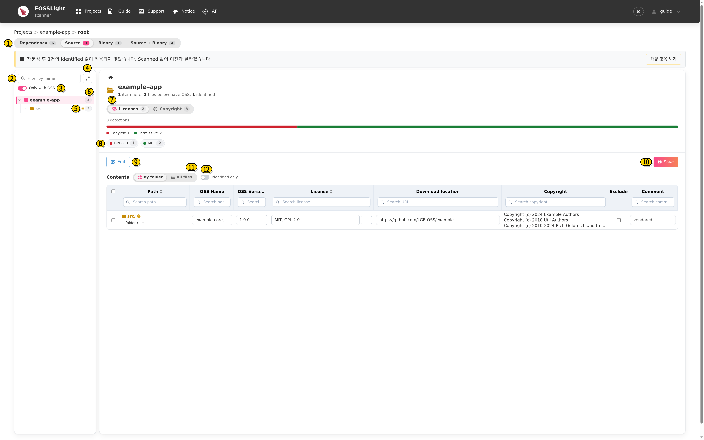
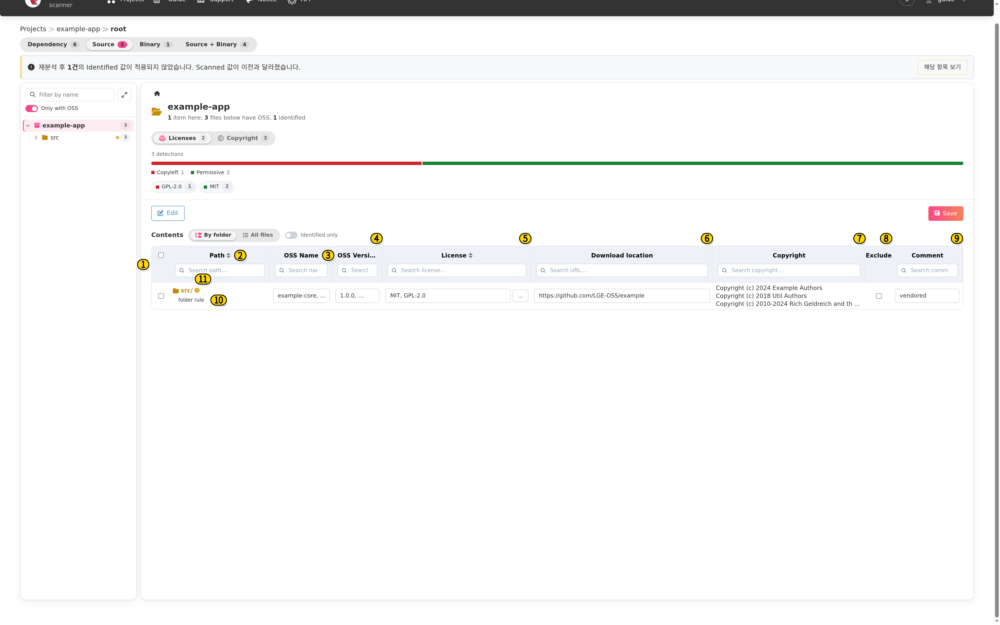
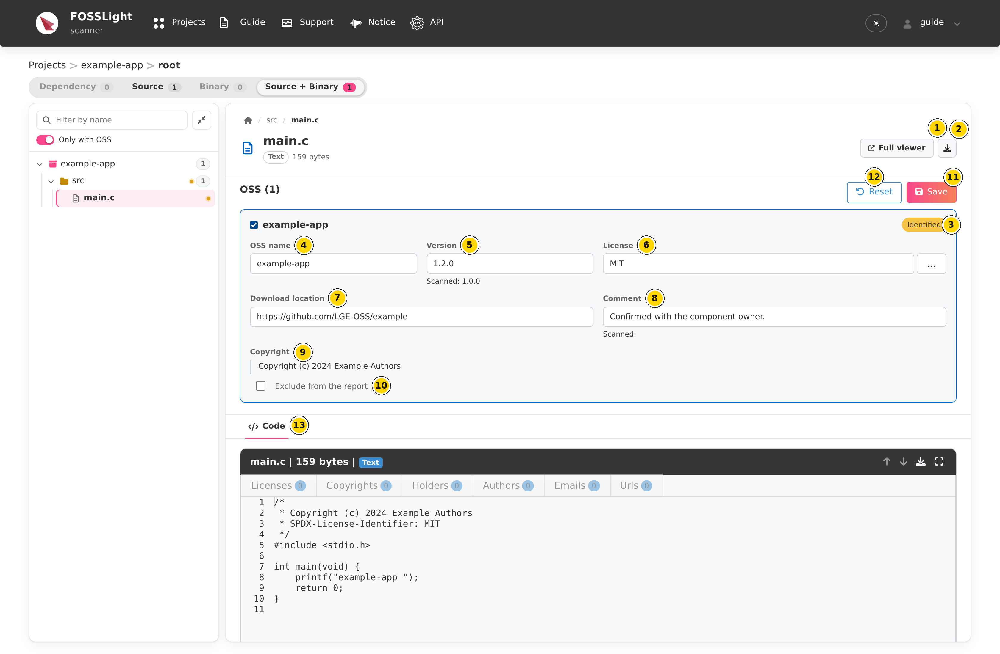
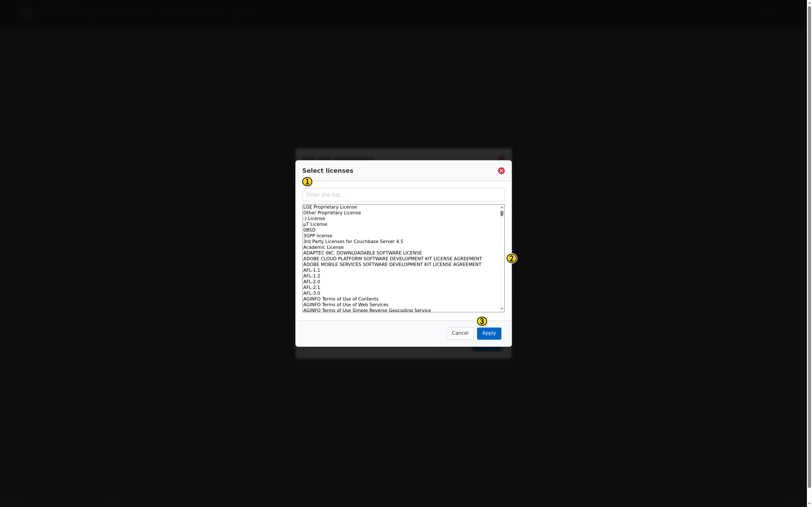
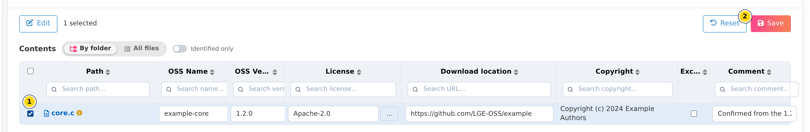
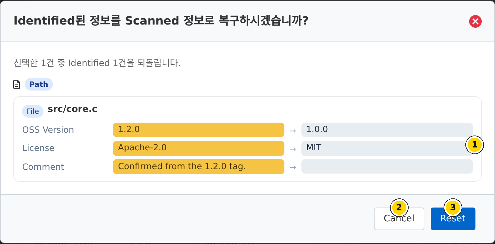
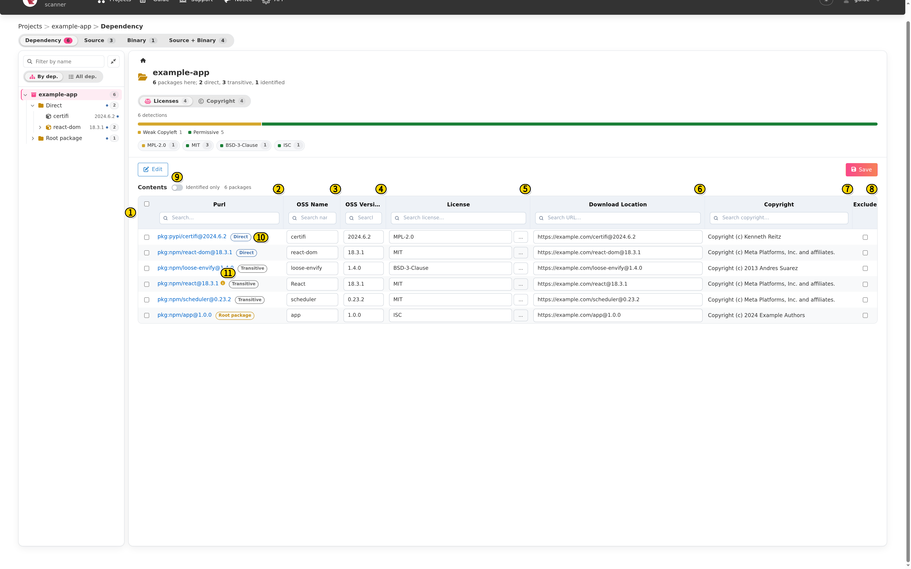
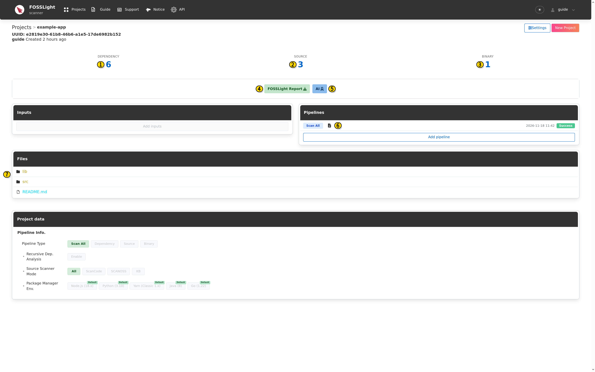
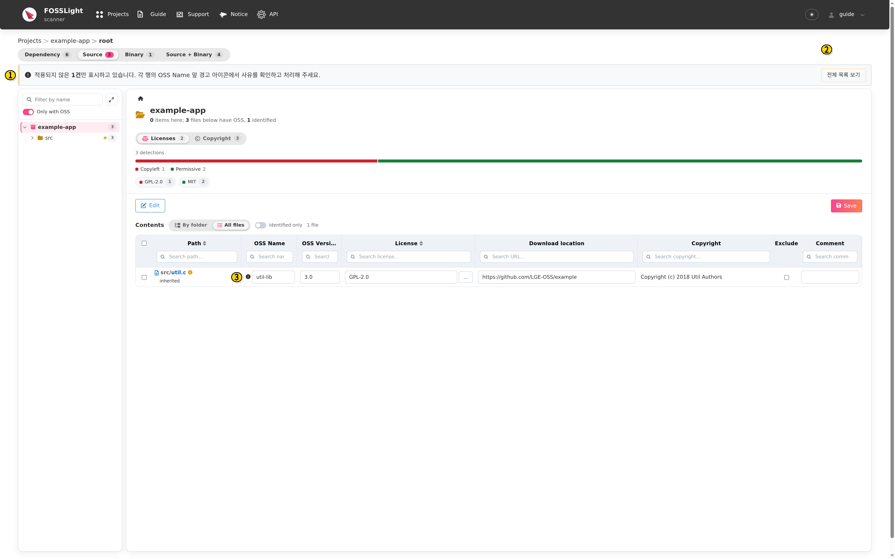
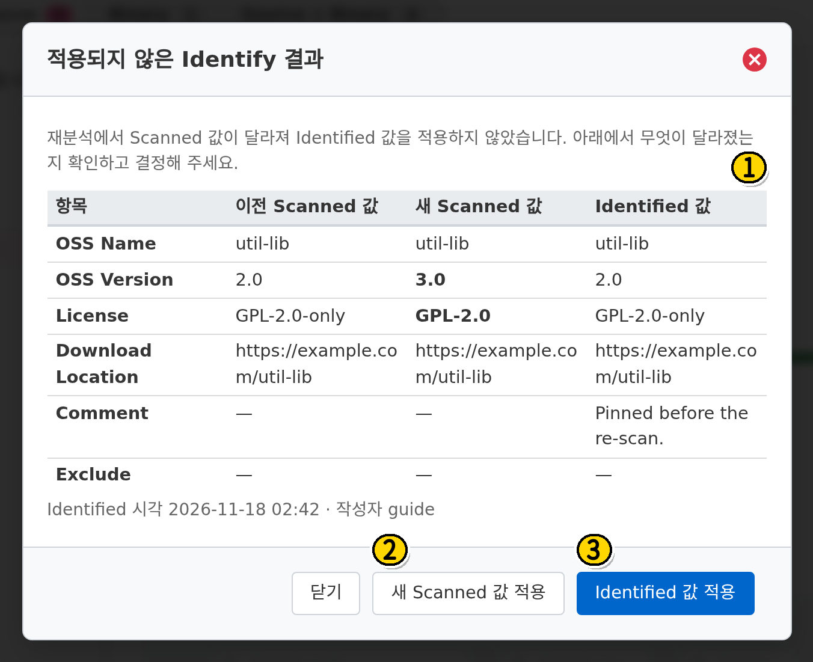

# Identify 기능이란?

> **Notice**  
> OSS Table에 **Reset**이 추가되었습니다. 행에 직접 저장한 Identified 값을 지우고, 그 행을 이번 분석의 Scanned 값으로 되돌립니다. 사용 방법은 [Reset](#identify-reset)을 참고합니다.

분석 결과 화면에서 스캐너가 분석한 OSS 정보를 확인하고 수정이 필요한 OSS 정보를 수정 후 저장하는 기능입니다. 

저장되는 정보는 OSS Name, OSS Version, License, Download location, Comment, Exclude입니다. Copyright는 스캔된 그대로의 값이라 Identify 기능으로는 수정할 수 없습니다.

Identified된 정보는 분석된(Scanned) 결과와 따로 보관됩니다.     
같은 프로젝트를 다시 분석하면 파일은 경로로, Dependency는 purl로 저장된 identified 정보가 나옵니다.     
Identified 정보가 하나라도 적용 중이면 [FOSSLight Report](https://fosslight.org/hub-guide/learn/2_fosslight_report.html) 다운로드는 그 값이 반영된 리포트입니다.    
- 다운로드 받는 Report명: **fosslight_report_YYMMDD_{UUID 일부}.xlsx**

Identified 작업이 끝났다면 이 report를 [FOSSLight Hub Identification](https://fosslight.org/hub-guide/tutorial/1_project/2_Identification/)에 업로드합니다.

## 누가 Identify 기능을 사용할 수 있나요?
{: .left-bar-title}

프로젝트의 Creator, Editor가 사용할 수 있습니다. Editor를 추가, 제거는 Settings에서 가능합니다.    

아래 상황에서는 Identify 기능을 이용할 수 없습니다.
- 분석이 대기 중이거나 실행 중인 경우
- 프로젝트가 archived된 경우

## Identify 기능 이용 방법
{: .left-bar-title}

프로젝트 화면의 Dependency, Source, Binary 개수를 누르면 아래와 같은 결과 화면이 열립니다.     

< Path 기반 >    
파일 식별은 경로에 저장됩니다. Source, Binary, Source + Binary에서 같은 파일을 열면 같은 저장 값이 보입니다. Source와 Binary를 오갈 때는 보고 있던 경로와 필터가 유지됩니다.

< 의존 관계 기반 >    
Dependency 식별은 purl에 저장됩니다. 파일 트리의 폴더 규칙과는 따로입니다.

{: .styled-image}

1. **결과 탭** : Dependency, Source, Binary, Source + Binary 탭 중 선택합니다. 
2. **Filter by name** : 이미 불러온 항목 중 이름에 글자가 포함된 것만 남깁니다.
3. **Only with OSS** : Source와 Binary 트리에서 OSS가 있는 파일만 보여 줍니다. 끄면 검출이 없는 파일도 트리에 나옵니다. 검출이 없는 파일에는 폴더 규칙이 적용되지 않습니다.
4. **접기 / 펼치기** : 불러온 폴더를 모두 접거나 펼칩니다.
5. **Status 점** : 파란색은 scanned며 노란색은 identified되었음을 나타냅니다. (아래 상세 설명)
6. **폴더 숫자** : 그 아래에 OSS가 있는 파일 수입니다.
7. **Licenses** : 선택한 폴더 아래에 검출된 라이선스를 유형 막대와 칩으로 보여줍니다.
8. **License chip** : 이름을 누르면 그 라이선스가 있는 경로만 남고 숫자를 누르면 그 라이선스가 있는 파일을 목록으로 엽니다.
9. **Copyright** : 선택된 path의 Copyright의 빈도별 개수를 확인할 수 있고 복사도 가능합니다.
10. **Edit** : 여러 행을 한 번에 수정하는 창을 엽니다.
11. **Save** : 칸에 직접 입력한 값을 저장합니다. 왼쪽 **Reset**은 선택한 행에 직접 저장한 Identified 값을 지우고 Scanned 값으로 되돌립니다.
12. **By folder / All files** : By folder는 선택한 폴더 바로 아래의 폴더와 파일입니다. 폴더 행을 고치면 폴더 규칙이 됩니다. All files는 그 아래 모든 깊이의 파일입니다.
13. **Identified only** : 상태가 Identified인 행만 남깁니다.

Column header 아래 검색은 내용의 일부만 맞아도 되고 대소문자를 구분하지 않습니다.    
여러 열을 함께 쓰면 모든 검색에 맞는 행만 남습니다.

## 상태(Status) 확인 방법
{: .left-bar-title}

한 행의 상태는 지금 화면에 보이는 값이 분석 결과(Scanned)와 같은지로 정해집니다.

- **Scanned** : 화면에 보이는 값이 이번 분석 결과 값과 같습니다. 파일 트리의 점은 파란색입니다.
- **Identified** : Identified 된 항목으로 파일 트리의 점은 노란색입니다. 파일 카드에는 Identified 또는 Scanned 태그가 붙습니다.
- **Partly identified** : 폴더 점만 해당합니다. 노란색이 반만 채워집니다. 그 폴더 아래에서 OSS가 있는 파일 중 일부만 Identified 된 것이고 그 폴더에는 폴더 규칙이 없습니다. 점에 마우스를 올리면 상태가 글로 나옵니다.
    - 폴더에 폴더 규칙이 있거나, 그 아래 OSS가 있는 파일이 모두 Identified면 폴더 점은 노란색입니다.      
    - Path 또는 Purl 옆 정보 아이콘은 그 경로나 패키지에 저장한 Identified 정보가 있다는 표시입니다. 마우스를 올리면 Identified라고 나옵니다.    
    - OSS가 없는 파일은 점이 없고 폴더 규칙도 받지 않습니다.         

{: .styled-image}

## Identify 이용 시 작성할 정보
{: .left-bar-title}

| Column | 작성할 정보 |
| --- | --- |
| OSS Name | 실제 사용한 OSS Name |
| OSS Version | Repo.에서 Tag로 확인 가능한 OSS Version |
| License | 확인한 라이선스. 여러 개는 쉼표로 작성하고, 순서만 바뀐 것은 변경으로 보지 않습니다. |
| Download location | Source Code를 다운로드 가능한 URL |
| Comment | 확인 메모. |
| Exclude | 체크하면 그 행은 FOSSLight Report에서 빠집니다. 파일 카드의 **Exclude from the report**와 같습니다. |
| Copyright | Scan값 그대로이므로 수정 불가. 길면 줄여 보여 주고 칸에 마우스를 올리면 전체를 봅니다. 3줄 이상이면 클릭하면 복사됩니다. |

수정하지 않고 **Save**를 누르면 그 칸은 Scanned 값으로 유지됩니다. 내용을 지우고 저장하면 그 값을 지운 것으로 남습니다.   

Identified된 값을 이전의 Scanned 값으로 다시 저장하거나 **Reset**하면 Identified 식별은 지워지고 Scanned로 돌아갑니다.   

한 경로에 스캐너가 찾은 OSS가 둘 이상이면 표에 행이 각 OSS로 등록되고 OSS마다 따로 저장합니다.

선택한 행이 없거나 바뀐 칸이 없는데 버튼을 누르면 알림이 나옵니다. 알림 문구는 `Select at least one row to edit.` 또는 `There are no changes to save.`입니다.

## Identify 하는 방법
{: .left-bar-title}

### 패키지/File 하나를 Identify 하는 방법
{: .specific-title}

1. Dependency 또는 File 하나를 클릭합니다.
2. OSS 카드에서 수정할 값을 직접 입력합니다. License는 칸에 적거나 오른쪽 **...** 로 목록에서 고릅니다.
3. **Save**를 누릅니다.
4. 저장이 끝나면 화면이 다시 열리고 상태가 바뀝니다.

{: .styled-image}

파일 카드에서 같이 보는 항목입니다. 번호는 위 화면과 같습니다.

1. **Full viewer** : 파일 세부 내용을 확인하는 메뉴입니다.   
2. **다운로드** : 파일을 다운로드 받습니다.
3. **Identified / Scanned** : Dependency 혹은 File의 상태를 보여줍니다.
4. **OSS name** : Open Source Software Name 입니다.
5. **Version** : Open Source Software Version 입니다.
6. **License** : 직접 입력하거나 오른쪽 **...** 로 라이선스 목록을 열어 선택할 수 있습니다.
7. **Download location** : OSS를 다운로드 할 수 있는 URL입니다.
8. **Comment** : Scan시 작성되는 값 또는 필요한 정보를 메모할 수 있습니다.
9. **Copyright** : Scan으로 확인되는 Copyright입니다.(수정 불가)
10. **Exclude from the report** : Report에서 제외하려면 체크합니다.
11. **Save** : 작성한 값을 저장하는 버튼입니다.
12. **Reset** : 이 카드에 직접 저장한 Identified 값을 지우고 Scanned 값으로 되돌립니다. 그 카드의 체크박스를 선택했을 때만 켜집니다.
13. **Code** : 매칭된 줄을 강조해서 보여 줍니다. Identified 값은 새로 매칭되지 않습니다.

패키지를 선택하면 같은 OSS 카드 항목과 함께 **Depends on**, **Required by**가 나와 의존 관계를 확인할 수 있습니다.

### 여러 개의 패키지/경로를 한 번에 Identify 하는 법(Bulk Edit)
{: .specific-title}

1. OSS Table에서 한번에 수정할 행 앞의 체크박스를 선택합니다. Table Header의 체크박스는  페이지의 행을 모두 선택합니다. 
2. **Edit**를 누릅니다.
3. 바꿀 항목만 체크합니다. 체크하지 않은 항목은 선택된 모든 행에서 그대로 둡니다.
4. 체크한 칸에 수정할 정보를 작성합니다. 값을 지우려면 그 항목을 체크하고 칸을 비웁니다.     
5. **Change**를 누릅니다. 선택된 모든 행에 바로 저장됩니다.

{: .styled-image}

### 라이선스 목록에서 고르기
{: .specific-title}

OSS Table과 file 카드에서는 **...** 를 바로 누릅니다.    
Bulk Edit의 경우, License 칸의 **...** 는 그 칸의 라이선스 체크박스를 체크한 뒤에 열립니다.     

1. **Filter the list**에 글자를 넣어 목록을 줄입니다.
2. 리스트에서 하나 이상을 선택합니다.
 - 목록에 없는 라이선스는 License 칸에 직접 작성 가능합니다.
3. **Apply**를 누릅니다. 고른 라이선스가 칸에 들어갑니다.    
이어서 **Save** 또는 **Change**로 저장합니다.

{: .styled-image}

### Reset으로 Scanned 값에 되돌리기
{: #identify-reset .specific-title}

행에 직접 저장한 Identified 값을 지우고, 이번 분석의 Scanned 값으로 되돌립니다.

OSS Table에서 되돌릴 행을 선택합니다. 그 행에 직접 저장한 값이 있을 때만 **Reset**이 켜집니다. 파일 카드와 Dependency 카드에서도 Save 왼쪽 **Reset**이 같습니다.

{: .styled-image}

1. **행 선택** : 되돌릴 행입니다. 선택하면 **Reset**이 켜집니다.
2. **Reset** : 확인 창을 엽니다.

{: .styled-image}

1. **비교** : 노란색은 지금 Identified 값이고, 회색은 돌아갈 Scanned 값입니다.
2. **Cancel** : 바꾸지 않습니다.
3. **Reset** : 저장이 지워지고 상태가 Scanned로 바뀝니다.

같이 고른 Scanned 행은 그대로 둡니다. 저장하지 않은 수정이 있으면 버릴지 먼저 묻습니다.  
폴더 행을 Reset하면 그 규칙과, 규칙이 적용되던 하위 경로가 함께 돌아갑니다. 더 위 폴더의 규칙이 있으면 그 값이 다시 적용됩니다. 규칙만 물려받은 행은 그 폴더 행에서 Reset합니다.  
재분석 후 적용되지 않은 행은 비교 창에서 처리합니다.

## 폴더 규칙(Folder Rule)
{: .left-bar-title}

폴더 행을 수정하여 Identified하면 그 폴더의 규칙이 됩니다.    
By folder에서 폴더를 선택하면 그 폴더 하위 folder/file이 OSS Table에 나옵니다. 규칙을 저장한 폴더 행에는 **folder rule**이 붙습니다.

규칙은 Source와 Binary 탭에서 그 폴더 하위에 이미 OSS가 검출된 경로에 적용됩니다.         
**OSS가 없는 파일, Dependency 패키지에는 적용되지 않습니다.**

< 적용 순서 >
1. 처음에 보이는 값은 Scanner가 분석한 Scanned 값입니다.
2. 더 상위 폴더의 규칙은 합쳐지지 않고 상위의 가장 가까운 폴더 규칙이 적용됩니다.     
3. 그 파일 행에 직접 저장한 값이 있으면 그 값이 최종입니다. (Folder rule 보다는 개별 파일 수정이 우선 적용)

Folder Rule이 적용된 경로에는 **inherited**로 표기됩니다. 파일에 직접 저장한 행에는 inherited가 붙지 않고 그 파일 값이 폴더 규칙보다 우선 적용됩니다.    

Identified 이후, 이전의 Scanned 값을 다시 저장하거나 그 폴더 행을 **Reset**하면 Folder Rule 적용은 해제됩니다.     
아래 폴더의 규칙을 모두 풀면, 더 상위 폴더 규칙이 다시 보입니다.

Folder Rule은 다시 분석해도 유지됩니다. 한 파일의 스캐너 값이 바뀌어도 Folder Rule 자체는 경고 대상이 되지 않습니다. 파일 행에 직접 저장한 값만 아래의 재분석 확인을 받습니다.

## Dependency에서 다른 점
{: .left-bar-title}

{: .styled-image}

- 행의 키는 Path가 아니라 **Purl**입니다. 같은 purl이 여러 manifest에 있어도 식별은 purl당 하나입니다.
- **Dependency 배지**는 Direct, Transitive, Root package 중 하나입니다. 식별 값과는 별개이고 고칠 수 없습니다.
- Purl 옆에 뜨는 i 모양 아이콘은 그 패키지를 Identify 했다는 표시입니다.
- Path 기반이 아니므로 Folder Rule은 없습니다.

By dep.은 Direct 아래 패키지의 종속 관계를 보여 줍니다.     
All dep.은 Direct, Transitive, Root package 그룹으로 패키지를 나열하고 중복되더라도 같은 패키지는 한 번만 보여 줍니다. 어느 쪽으로 보든 저장되는 purl은 같습니다.

## FOSSLight Report
{: .left-bar-title}

프로젝트 화면의 **FOSSLight Report**는 Hub Identification에 올리는 파일입니다.

- 적용 중인 Identified 값이 있다면 이 값이 반영된 리포트를 받습니다.
- 아직 Identified 값이 전혀 없으면 Scanned된 결과 그대로의 리포트를 받습니다.
- Exclude를 체크한 행은 리포트에서 빠집니다.
- 프로젝트 목록의 Download 아이콘으로도 리포트를 받을 수 있습니다.

Identified 값을 이전의 Scanned 값과 같게 되돌려 저장 기록이 모두 사라지면, 이후 다운로드는 다시 스캐너 결과 리포트입니다.

## Identify 사용 절차
{: .left-bar-title}

분석이 끝난 프로젝트에서 스캔 결과를 확인하고, 수정할 OSS 정보를 작성하는 순서입니다.     

### 1. 상세 결과 화면을 엽니다
{: .specific-title}

1. 프로젝트 화면에서 확인할 Dependency, Source, Binary 개수를 누릅니다.
2. Source와 Binary는 왼쪽 트리에서 경로로 파일을 확인할 수 있고 Dependency는 purl로 패키지를 확인할 수 있습니다.

{: .styled-image}

{: .styled-image}

{: .styled-image}

### 2. Identify기능으로 수정할 행을 확인합니다
{: .specific-title}

1. **Only with OSS**를 켜면 OSS가 검출된 파일만 트리에 나옵니다.
2. 폴더를 누르면 바로 아래 폴더와 파일이 표에 나옵니다. 더 아래까지 보려면 **All files**를 누릅니다.
3. Column Header 아래 검색으로 경로, 이름, 라이선스를 검색하여 필터링할 수 있습니다.

{: .styled-image}

### 3-1. 1개의 파일 / 패키지만 수정할 경우
{: .specific-title}

파일 또는 패키지 하나를 누릅니다.

1. OSS 카드에서 OSS Name, Version, License, Download location, Comment를 고칩니다. License는 칸에 적거나 **...** 로 목록에서 고릅니다.
2. 리포트에서 빼려면 **Exclude from the report**를 체크합니다. Copyright는 스캔된 값이라 고칠 수 없습니다.
3. **Save**를 누릅니다. 화면이 다시 열리고 상태가 Identified로 바뀝니다.
- Tree의 Status별 컬러
    - 파란색: Scanned
    - 노란색: Identified
        - 노란색이 반만 채워지면 그 폴더 하위의 일부만 Identified입니다.

{: .styled-image}

### 3-2. 여러 OSS 정보를 일괄 수정할 경우
{: .specific-title}

같은 수정을 여러 파일이나 패키지에 넣을 때 씁니다.

1. OSS Table에서 고칠 행의 체크박스를 선택합니다. 머리의 체크박스는 그 페이지의 행을 모두 선택합니다.
2. **Edit**를 누릅니다.
3. 바꿀 항목만 체크하고 값을 적습니다. 체크하지 않은 항목은 선택된 행에서 그대로 둡니다. 값을 지우려면 그 항목을 체크하고 칸을 비웁니다.
4. **Change**를 누릅니다. 선택한 행에 바로 저장됩니다.

표의 값이 이번 분석 결과와 같으면 상태는 Scanned입니다. 저장한 값이 다르면 Identified입니다.

수정하지 않은 칸은 Scanned 값으로 남습니다.

{: .styled-image}

### 3-3. 폴더에 같은 값을 적용할 경우
{: .specific-title}

한 폴더 아래의 파일에 같은 OSS 정보를 적용할 때 씁니다. Dependency에는 이 규칙이 없습니다.

1. Source 또는 Binary 탭에서 **By folder**로 그 폴더를 선택합니다.
2. 표에 나온 폴더 행을 고치고 저장합니다. 그 행에 **folder rule**이 붙습니다.
3. 그 폴더 아래 OSS가 있는 경로는 이 값을 물려받고 **inherited**로 표시됩니다. OSS가 없는 파일에는 적용되지 않습니다.
4. 파일 하나를 따로 저장하면 그 파일 값이 폴더 규칙보다 우선합니다.
5. 더 위 폴더에도 규칙이 있으면, 그 경로에 더 가까운 폴더 규칙만 적용됩니다.

적용된 규칙을 복구하려면 그 폴더 행에서 이전 Scanned 값을 다시 저장하거나 **Reset**합니다.     
우선순위가 높은 하위 폴더의 규칙을 모두 풀면 더 상위 폴더 규칙이 다시 보입니다.    
적용된 폴더 규칙은 재분석해도 유지됩니다.

{: .styled-image}

### 4. 저장한 값을 되돌립니다(Reset)
{: .specific-title}

Identify 기능으로 수정한 정보를 Scanned 정보로 되돌릴 때 씁니다.

1. OSS Table에서 되돌릴 행을 선택합니다. 파일 카드나 Dependency 카드에서는 그 카드의 체크박스를 선택합니다. 
- 그 행에 직접 저장한 값이 있을 때만 **Reset**이 켜집니다.
2. **Reset**을 누르면 팝업창이 뜹니다. 팝업 창에서 노란색은 Identified 값이고, 회색은 복구할 Scanned 값입니다.
3. **Reset**을 누르면 저장이 지워지고 상태가 Scanned로 바뀝니다.     

같이 선택된 Scanned 행은 바꾸지 않습니다.     
저장하지 않은 수정이 있으면 버릴지 먼저 묻습니다.  
폴더 규칙만 적용된 행은 그 폴더 행에서 Reset합니다.     
- 폴더 행을 Reset하면 그 규칙과 적용되던 하위 경로가 함께 돌아갑니다. 더 상위 폴더의 규칙이 있으면 그 값이 다시 적용됩니다.

{: .styled-image}

{: .styled-image}

### 5. 리포트를 받아 Hub에 올립니다
{: .specific-title}

1. 프로젝트 화면에서 **FOSSLight Report**를 받습니다. 프로젝트 목록의 Download 아이콘으로도 받을 수 있습니다.
- 파일명은 **fosslight_report_YYMMDD_{UUID 일부}.xlsx**입니다.
2. Identified 값이 하나라도 적용 중이면 그 값이 들어 있는 리포트입니다.
- 저장한 값이 없으면 스캐너 결과 그대로입니다.     
- Exclude를 체크한 행은 리포트에 없습니다.
3. 받은 파일을 [FOSSLight Hub Identification](https://fosslight.org/hub-guide/tutorial/1_project/2_Identification/)에 업로드합니다.

{: .styled-image}

### 동일 프로젝트를 재분석 시, Identified 정보와 다른 값으로 검출될 경우
{: .specific-title}

같은 프로젝트를 다시 분석하면, 같은 경로의 파일과 같은 purl의 패키지에 저장된 정보는 **Scanned 값이 아닌 identified 값**으로 보여집니다.

이름, 버전, 라이선스, Download location, Comment, Exclude가 저장된 값과 모두 같을 때만 그 값이 자동으로 다시 보입니다. 하나라도 달라지면 화면은 새 스캐너 값을 보여주고, 표 위에 경고가 나옵니다.   

{: .styled-image}

1. **경고**는 재분석 후 적용되지 않은 건수입니다. 문구는 `재분석 후 N건의 Identified 값이 적용되지 않았습니다. Scanned 값이 이전과 달라졌습니다.`입니다.
2. **해당 항목 보기**를 눌러 적용되지 않은 행만 엽니다. 그때 문구는 `적용되지 않은 N건만 표시하고 있습니다.`로 바뀌고, 버튼은 **전체 목록 보기**가 됩니다.
3. OSS Name 앞의 경고 아이콘을 눌러 이전 Scanned 값, 새 Scanned 값, Identified 값을 비교합니다. 여기서 처리하기 전에는 그 행의 저장 값이 적용되지 않습니다.

{: .styled-image}

비교 창 제목은 `적용되지 않은 Identify 결과`입니다. 달라진 새 Scanned 값은 굵게 표시되고, 아래에는 Identified 시각과 작성자가 나옵니다.

1. 새 스캔 결과를 쓰려면 **새 Scanned 값 적용**을 누릅니다. 저장해 둔 Identified 값은 지워지고 새 스캐너 값을 사용합니다.
2. 저장해 둔 값을 유지하려면 **Identified 값 적용**을 누릅니다. 그 값이 새 스캐너 값 위에 다시 올라가고, 이후 비교 기준은 이번 스캐너 값이 됩니다.
3. **닫기**는 값을 그대로 둡니다. 경고와 아이콘은 남습니다.

이번 분석에 없는 경로나 purl의 기록은 목록에 나오지 않고, 경고 건수에도 들어가지 않습니다.
- 최초 Source만 분석 후, 재분석 시 Dependency를 분석한다면 Source 분석 결과는 보이지 않습니다.(가장 최신 분석인 Dependency 분석 결과만 보임)

다음 분석에 같은 경로나 purl이 다시 나오면 그 기록이 돌아옵니다.
Source만, Binary만, Dependency만 다시 분석하면 이번 분석이 만들지 않은 종류의 저장 값은 그대로 둡니다. Source만 다시 분석해도 Dependency에 저장한 값은 그대로 둡니다. 폴더 규칙은 이 경고로 지워지지 않고, OSS가 있는 하위 경로에 계속 적용됩니다.
